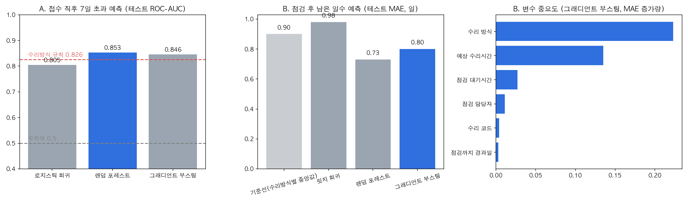
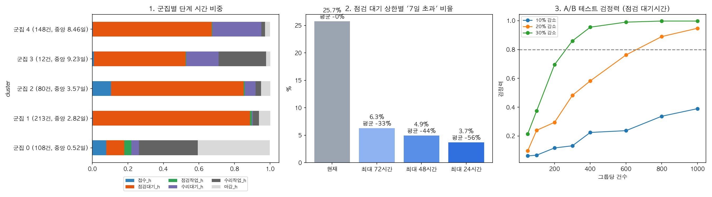

# 집 수리 요청 프로세스 분석

집 수리 요청 이벤트 로그(수리 요청 1,000건, 기록 13,262줄)를 **Python으로 분석**하고, 같은 결과가 나오는지 **SQL(DuckDB)로 다시 계산해 검증**한 프로젝트입니다.
이후 **scikit-learn 예측 모델, 군집, 개선 효과 시뮬레이션, A/B 테스트 설계**를 추가했습니다.

## 질문과 결과

| 질문 | 결과 |
|---|---|
| 수리 요청은 어떻게 진행되는가 | 경로 16가지, 상위 3개가 전체의 81% |
| 시간은 어디서 가장 오래 걸리는가 | 단계 사이 시간의 74.8%가 현장 점검을 기다리는 시간 (중앙값 약 49시간). 점검 작업 자체는 중앙값 41분 |
| 소요시간에 영향을 주는 요인은 | 수리 유형이 가장 큼. 중앙값 B형 0.47일 · P형 2.83일 · E형 6.22일. 반복 수리, 작업자 쏠림, 요청 채널은 영향 없음 |
| 무엇을 바꾸면 좋은가 | 점검 대기 단축(목표 시간과 지연 알림, 담당자 일정 교차 배정), 점검 후 수리 자동 배정, 기록 입력 검증 |

## SQL 재검증에서 발견한 것

| 항목 | Python | SQL |
|---|---|---|
| 점검 대기 중앙값 | 49시간 | 49.2시간 |
| 수리 유형별 소요시간 중앙값 | 0.47 / 2.83 / 6.22일 | 0.47 / 2.83 / 6.22일 |
| 잘못된 장소 경로 비율 | 7.3% | 12.1% |

- **같은 시각에 끝난 업무 805건**: 시각만으로 정렬하면 순서가 정해지지 않아 실행할 때마다 결과가 달라짐. 표준 업무 순서를 정렬 기준에 추가해 결과를 고정했고, Python 결과와 일치함을 확인
- **이상 데이터 제외에 따른 치우침**: 이상 날짜는 기록마다 약 6.5% 확률로 섞여 있어, 기록이 많은 케이스일수록 더 많이 걸러짐. 이상 케이스를 통째로 빼면 짧은 경로 비율이 7.3%에서 12.1%로 부풀려짐. 케이스를 빼는 대신 순서를 복원한 Python 분석 방식이 더 적절했음을 확인

## 추가 분석: 예측 모델 · 군집 · 개선 효과 · A/B 테스트

| 질문 | 방법 | 결과 |
|---|---|---|
| 접수 직후, 7일 넘게 걸릴 요청을 미리 알 수 있나 | 분류 (로지스틱 회귀, 랜덤 포레스트, 그래디언트 부스팅) | 랜덤 포레스트 AUC 0.853. 단, 수리 유형만 보는 단순 규칙도 0.826으로 차이가 작음 → 접수 단계에서는 "E형 우선 점검" 규칙으로 충분 |
| 점검 후, 완료까지 며칠 남았나 | 회귀 (릿지, 랜덤 포레스트, 그래디언트 부스팅) | 평균 오차 0.90일(수리 유형별 중앙값) → 0.73~0.78일, 약 13~19% 개선 |
| 시간이 새는 유형이 따로 있나 | K-Means 군집 (k는 실루엣 점수로 선택) | 5개 유형. E형 장기 대기 군집(26%)은 점검 대기 약 133시간 + 수리 대기 약 42시간, 60%가 7일 초과 |
| 점검 대기를 줄이면 얼마나 빨라지나 | 시나리오 시뮬레이션 | 점검 대기를 최대 72시간으로 제한하면 7일 초과 25.7% → 6.3%, 평균 소요시간 33% 감소 (다른 단계는 그대로라고 가정) |
| '점검 지연 알림'을 실험하려면 | A/B 테스트 검정력 시뮬레이션 (Mann-Whitney U, α=0.05, 검정력 80%) | 대기 30% 감소 효과: 그룹당 300건(약 5일치 접수), 20% 감소: 그룹당 800건(약 13일치) |




- **누수 방지**: 예측 시점에 아직 모르는 정보(점검 결과, 점검 담당자, 실제 경로, 수리 성공 여부)는 변수에서 제외
- **검증 방식**: 접수 순서대로 앞 80% 학습, 뒤 20% 테스트. 하이퍼파라미터는 학습 구간 안에서 TimeSeriesSplit + GridSearchCV로 고르고, 테스트 구간은 마지막에 한 번만 사용
- **한계**: 접수 기간이 8일치뿐이라 테스트 구간이 약 1.5일로 짧음. 교차검증 AUC(0.70)와 테스트 AUC(0.85)의 차이도 이 때문이라 성능 수치는 보수적으로 해석

## 폴더 구성

```
Python/
  q1.py                  전처리와 기본 분석
  q2_1.py                현재 프로세스 (경로, 프로세스 맵)
  q2_2.py                문제점 (병목, 작업자 부하, 재작업)
  q2_3.py                소요시간 영향 요인 (Kruskal-Wallis, Spearman, 설명력 비교)
  q3_model.py            소요시간 예측 모델 (분류·회귀, GridSearchCV 튜닝)
  q4_cluster_ab_sim.py   K-Means 군집, 개선 효과 시뮬레이션, A/B 테스트 검정력
  q3_q4_report.ipynb     q3·q4 결과를 설명과 함께 정리한 노트북 (실행 결과 포함)
SQL/
  repair_sql_analysis.ipynb   SQL 재검증 노트북 (설명과 실행 결과 포함)
```

## 실행 방법

원본 데이터(`repair2.csv`)는 저장소에 포함하지 않았습니다.

- Python: `repair2.csv`를 `Python/` 폴더에 두고 `Python/` 폴더 안에서 `q1.py` → `q2_1.py` → `q2_2.py` → `q2_3.py` → `q3_model.py` → `q4_cluster_ab_sim.py` 순서로 실행 (앞 단계 결과를 다음 단계가 사용)
  필요한 라이브러리: `pip install pandas numpy matplotlib scipy scikit-learn`
- SQL: Colab에서 노트북을 열고 `repair2.csv`를 같은 폴더에 올린 뒤 런타임 → 모두 실행

## 사용 도구

Python(pandas, numpy, scipy, scikit-learn, matplotlib), DuckDB(SQL), Jupyter Notebook, Google Colab, GitHub

분석 방향 설정, 코드 작성과 오류 수정에 Claude를 활용했고, 결과는 Python과 SQL을 서로 대조해 검증했습니다.
